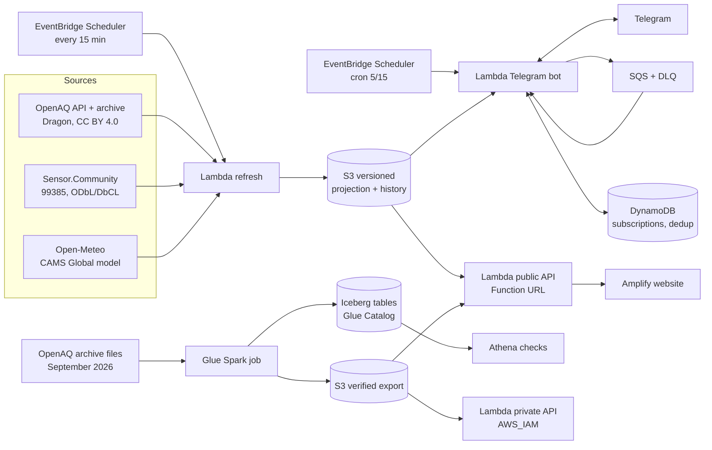

# AirLake

AirLake is a Hanoi PM2.5 information service built on AWS for a university
Cloud Computing course. It publishes real measurements from the two outdoor
sensors in Hanoi whose data may be redistributed, keeps a cleaned rolling
history of them, adds a clearly labelled regional model estimate for every
phường/xã, sends Telegram threshold alerts and offers the cleaned data through
a public read-only API.

| | |
|---|---|
| Website | https://public.dhyvgpdsnj4zi.amplifyapp.com |
| Data API | https://npe6uhbknh4qojnmylv3w436mi0epxfb.lambda-url.ap-southeast-2.on.aws/v1 |
| Telegram bot | https://t.me/AirLakeHanoiBot |

## Problem

Hanoi residents see PM2.5 numbers without knowing where they were measured,
when, or whether they apply to their own area. Researchers need cleaned,
licensed history with explicit gaps. AirLake shows what is actually measured,
where and when, says where no sensor exists, and keeps model estimates apart
from measurements.

## What it does

- **Location first.** Pick any of the 126 current phường/xã (OpenStreetMap
  boundaries after the July 2025 reorganisation), use the browser's location
  (rounded to ~1 km) or tap the map.
- **Real measurements.** Gia Lâm · Ocean Park (AirGradient "Dragon" via
  OpenAQ, hourly) and Tây Hồ (Sensor.Community 99385, ~150 s). Each value shows
  its observation time and a source-specific freshness state.
- **Regional model.** CAMS Global (via Open-Meteo) estimate and forecast for
  the selected area. The 126 areas fall into 5 native 0.4° (~45 km) model
  cells; areas in one cell share one value, and the page says so.
- **History.** Rolling 24 hours, previous 7 and 30 complete Vietnam-time days,
  a custom range since 2026-09-01, and the September 2026 lakehouse archive.
  Missing and provisional hours are reported, never filled.
- **Telegram alerts.** Subscribe to one of the two sensors with a threshold;
  one alert per crossing, deduplicated, with unsubscribe and data deletion.
- **Research data.** Hourly and daily JSON/CSV with coverage, flags,
  provenance and a licence notice per dataset.

## Architecture

Only components that run on AWS are shown; see
[docs/architecture.md](docs/architecture.md) for details and for components
that were planned or used only locally.



Secrets Manager holds the OpenAQ key and bot secrets; scoped IAM roles per
function; CloudWatch keeps logs and three alarms (throttles, traffic, refresh
errors).

## Data and limitations

| Data | Kind | Licence | Public |
|---|---|---|---|
| Gia Lâm · Ocean Park (Dragon) | low-cost sensor, hourly mean | CC BY 4.0, changes stated | yes |
| Tây Hồ (Sensor.Community 99385, approximate location) | low-cost SDS011 | ODbL 1.0 / DbCL 1.0; derived database under ODbL 1.0 | yes |
| CAMS Global via Open-Meteo | model, ~45 km cells | CC BY 4.0, Copernicus credit | yes, labelled model |
| Hanoi network stations (e.g. Nhân Chính, Giải Phóng) | reference monitors | no redistribution licence | no (private IAM API only) |

- Two sensors do not describe the city; they are low-cost, not humidity
  corrected, 14 km apart and systematically offset from each other.
- CAMS showed a seasonal bias against the sensors (September 2026: +16.9 and
  +32.3 µg/m³); it is shown as a trend, never as a ward measurement.
- No official VN_AQI is computed. An internal `aqi` column survives only in the
  September lakehouse export and is labelled as such.

Details: [rolling history and freshness](docs/rolling-history-and-freshness.md),
[station licensing](docs/hanoi-station-licensing.md),
[coverage and model](docs/hanoi-coverage-and-forecast.md).

## Repository

| Path | Contents |
|---|---|
| `nowcast/` | refresh Lambda, rolling history, CAMS per-area grouping, public API |
| `telegram_bot/` | product bot: webhook, policy, evaluation, delivery |
| `citizen/` | website (`web/`) and Amplify release helpers |
| `historical/` | September 2026 backfill, Glue job, analytics, private API |
| `scripts/` | frozen release tools, history backfill, local pipeline jobs |
| `tests/`, `tests/evidence/` | unit/integration tests and release receipts |
| `docs/` | current and historical documentation ([index](docs/README.md)) |
| `ingestion/`, `live_data/`, `final_demo/`, `clean_api/`, `alerts/`, `bot_lambda/`, `dashboard/`, `infra/local/` | earlier pipeline stages, bounded AWS trials, local tools (see the index) |

## Local setup and tests

Requires Python 3.12 and [uv](https://docs.astral.sh/uv/).

```bash
uv sync --frozen
uv run python -m unittest discover -s tests   # 590 tests, offline
uv run ruff check nowcast telegram_bot citizen scripts
```

Tests use synthetic fixtures and never call AWS. Building the website bundle
needs the verified September export, which is not stored in Git. AWS changes
are made only through the frozen release tools in `scripts/`, each with a
SHA-256-pinned plan, a read-only preflight, a per-write receipt and no
automatic retry.

## Evidence

- [Final evidence package](docs/final-evidence-package.md): running services,
  row counts, browser acceptance, CloudWatch results.
- `tests/evidence/`: receipts for every AWS release (nowcast, Telegram,
  rolling history, final release, site cleanup) and the September Glue run.
- [Architecture and deviations from the original plan](docs/final-product-and-architecture.md).
