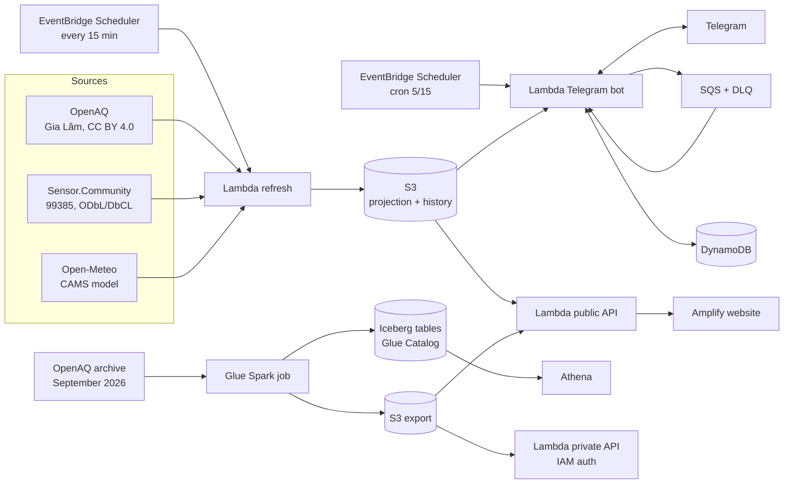

# AirLake

AirLake is a PM2.5 information and alert service for Hanoi, built on AWS by
team 14 for the Cloud Computing course (INT3319 2, VNU University of
Engineering and Technology). It publishes real measurements from the two
outdoor sensors in Hanoi whose data may be redistributed, keeps a cleaned
rolling history of them, shows a clearly labelled model estimate for every
phường/xã, sends Telegram threshold alerts and offers the data through a
public read-only API.

| | |
|---|---|
| Website | https://public.dhyvgpdsnj4zi.amplifyapp.com |
| Data API | https://npe6uhbknh4qojnmylv3w436mi0epxfb.lambda-url.ap-southeast-2.on.aws/v1 |
| Telegram bot | https://t.me/AirLakeHanoiBot |

## Features

- **Location first.** Pick one of the 126 current phường/xã, use the browser's
  location (rounded to about 1 km) or tap the map.
- **Real measurements.** Gia Lâm · Ocean Park (AirGradient via OpenAQ, hourly)
  and Tây Hồ (Sensor.Community 99385, about every 150 s), each with its
  observation time and freshness state.
- **Model estimate.** CAMS Global (via Open-Meteo) estimate and forecast for
  areas without a nearby sensor, always labelled as a model.
- **History.** Last 24 hours, 7 and 30 days or a custom range since
  2026-09-01, with missing and provisional hours shown, never filled.
- **Telegram alerts.** Choose a sensor and a threshold; one alert per
  crossing, no duplicates, unsubscribe at any time.
- **Research data.** Hourly and daily JSON/CSV with coverage, quality flags
  and the licence of each station.

## Architecture



Secrets Manager holds the OpenAQ key and bot secrets, each function has its
own IAM role, and CloudWatch keeps logs and three alarms. Details and the
comparison with the original design: [docs/architecture.md](docs/architecture.md).

## Data sources

| Data | Kind | Licence | Public |
|---|---|---|---|
| Gia Lâm · Ocean Park (OpenAQ 6123215) | low-cost sensor, hourly mean | CC BY 4.0 | yes |
| Tây Hồ (Sensor.Community 99385, approximate location) | low-cost SDS011 | ODbL 1.0 / DbCL 1.0 | yes |
| CAMS Global via Open-Meteo | model, ~45 km cells | CC BY 4.0, Copernicus credit | yes, labelled as model |
| Hanoi network stations (Nhân Chính, Giải Phóng) | reference monitors | no redistribution licence | no (private API only) |
| 126 phường/xã (OpenStreetMap) | approximate centres | ODbL 1.0 | yes |

Limitations: two low-cost sensors do not describe the whole city; they are
not humidity corrected, 14 km apart and systematically offset. CAMS was
biased high in September 2026 and is shown only as a trend. No official
VN_AQI is computed.

## Repository

| Path | Contents |
|---|---|
| `nowcast/` | refresh Lambda, rolling history, CAMS per-area estimates, public API |
| `telegram_bot/` | Telegram bot: webhook, alert policy, evaluation, delivery |
| `citizen/` | website (`web/`) and Amplify release |
| `historical/` | September 2026 lakehouse: Glue job, Athena checks, private API |
| `scripts/` | release scripts, history backfill, local Bronze/Silver/Gold jobs |
| `tests/` | offline tests; `tests/evidence/` holds release receipts |
| `docs/` | architecture, API, bot, data and licensing notes, original specification |
| `survey/` | first OpenAQ survey scripts |
| `alerts/`, `bot_lambda/`, `live_data/`, `final_demo/`, `ingestion/`, `clean_api/`, `dashboard/`, `infra/local/` | earlier stages: staging alert pipeline, AWS trials and local tools ([details](docs/architecture.md#earlier-aws-work-kept-in-the-repository)) |

## Setup and tests

Requires Python 3.12 and [uv](https://docs.astral.sh/uv/).

```bash
uv sync --frozen
uv run python -m unittest discover -s tests   # 590 offline tests
uv run ruff check nowcast telegram_bot citizen scripts
```

Tests use synthetic data and never call AWS. Building the website bundle needs
the September export, which is not stored in Git. Deployment steps are in
[docs/deployment.md](docs/deployment.md).

## Documentation

- [Architecture](docs/architecture.md)
- [Deployment](docs/deployment.md)
- [Public API](docs/public-api.md)
- [Telegram bot](docs/telegram-bot.md)
- [Rolling history and freshness](docs/rolling-history-and-freshness.md)
- [Coverage and model estimate](docs/hanoi-coverage-and-forecast.md)
- [Station licensing](docs/hanoi-station-licensing.md)
- [Original specification (Vietnamese)](docs/specification.md)

## Team

| Member | Role | Main work |
|---|---|---|
| Chung Thị Mai Anh (leader) | Data Engineer | coordination; Bronze/Silver/Gold pipeline; Glue/Iceberg/Athena lakehouse; near-real-time refresh and rolling history; public API, website and Telegram bot; integration and AWS deployment |
| Trần Minh Khuê | Cloud/DevOps Engineer | AWS account, IAM and budgets; Terraform stacks and CI checks; first S3/Glue/Athena runs; staging alert pipeline (SNS, SQS + DLQ, Lambda, DynamoDB) and its Athena checks |
| Hoàng Khánh Nam | Data Platform Engineer | on branch `nam`: Kafka cluster, Trino stack, CloudWatch monitoring, chaos and benchmark scripts |
| Nguyễn Phúc Thịnh | Backend & QA Engineer | on branch `thinh`: first Telegram bot version and DynamoDB table, k6 load scripts |
